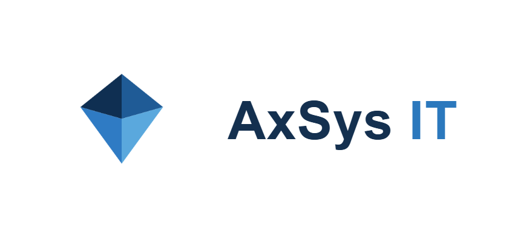
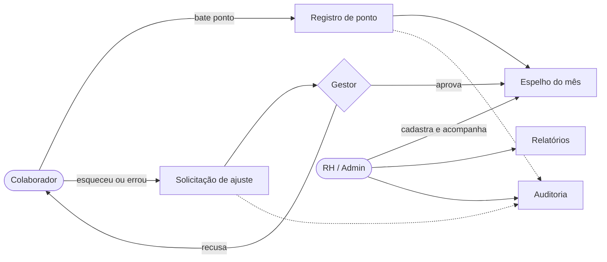
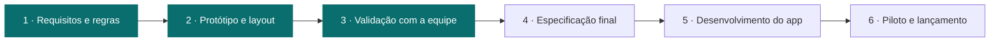

<div align="center">



# AxSys IT · Projetos de Software

**Repositório privado de projetos de software da [AxSys IT](https://axsys.com.br)**
Estudos, validações e especificações antes de qualquer linha de código.


</div>

---

## O que é este repositório

Aqui a AxSys IT guarda tudo o que envolve **projetos de software próprios**: o que o produto precisa fazer, como cada tela se parece, como o usuário se movimenta e por que cada decisão foi tomada.

> **Regra de trabalho:** primeiro validamos o produto em protótipo e documento. Só depois escrevemos o código do app real. Cada mudança validada no protótipo é registrada aqui.

## Projeto ativo: AxPonto

Sistema web de **registro de ponto**. O colaborador bate o ponto pelo navegador, acompanha o espelho do mês e pede ajustes. O gestor aprova. O RH cadastra, acompanha e emite relatórios.

| | |
|---|---|
| **Nome de trabalho** | AxPonto (pode mudar) |
| **Plataforma** | Web, responsivo (computador e celular) |
| **Fase atual** | Validação de requisitos, interface e fluxos |
| **Protótipo** | [`prototipo/index.html`](prototipo/index.html) (também publicado como artefato do Claude) |
| **Código do app** | Ainda não iniciado, por decisão |

### Como o sistema funciona, em uma imagem



### Quem usa

| Perfil | O que faz | Telas principais |
|---|---|---|
| 👤 **Colaborador** | Registra o ponto com **localização obrigatória, mapa e selfie**, confere o espelho, pede ajustes e ausências, vê a escala | Registrar ponto · Meu espelho · Ajustes · Ausências · Escala · Alertas |
| 🧭 **Gestor** | Acompanha a equipe, decide ajustes, ausências e espelhos, monta escalas | Minha equipe · Painel de exceções · Aprovações · Escalas |
| 🗂️ **RH** | Cadastra pessoas e organização, fecha o mês, gera relatórios | Visão geral · Colaboradores · Organização · Relatórios · Integrações · Configurações |
| 🛠️ **Administrador** | Tudo do RH, mais segurança | Mesmas do RH |

### O que o protótipo já cobre

Resultado do [estudo de 10 sistemas de ponto](docs/09-benchmark-concorrentes.md) (UKG, Deputy, Connecteam, Clockify, Jibble, Homebase, When I Work, Rippling, QuickBooks Time e Buddy Punch), mais a referência brasileira (Pontomais e Portaria 671). São **105 funções catalogadas** na [matriz de funcionalidades](docs/10-matriz-de-funcionalidades.md).

| Grupo | Funções |
|---|---|
| **Registro** | Web, quiosque com PIN, selfie, QR Code, offline, projeto por batida, comprovante numerado |
| **Local e antifraude** | Localização obrigatória com mapa, cerca virtual por unidade, três modos para batida fora da área, alerta de aparelho diferente |
| **Regras da CLT** | Tolerância, intervalo, 6h sem pausa, extras 50% e 100%, adicional noturno, interjornada, banco de horas, feriados |
| **Escalas e ausências** | Escala semanal, folga e plantão, férias com saldo, atestado, licença, abono, folga compensatória |
| **Fechamento** | Espelho assinado, aprovado e fechado, com mês travado |
| **Gestão** | Painel de exceções, custo de mão de obra, realizado contra previsto, mural de avisos |
| **Relatórios** | Consolidado, extras, atrasos, banco de horas, projetos, localização, eventos de folha, AFD e AEJ |
| **Cadastro** | Ficha completa (setor, cargo, gestor, unidade, contrato e mais), setores, unidades, projetos, jornadas |
| **Configuração** | Políticas de ponto, métodos de registro, segurança, integrações simuladas |

## Mapa da documentação

| Documento | Para que serve | Situação |
|---|---|---|
| [01 · Visão do produto](docs/01-visao-do-produto.md) | Problema, objetivos, escopo e o que fica de fora | ✅ Rascunho validado |
| [02 · Requisitos](docs/02-requisitos.md) | Requisitos funcionais e não funcionais com prioridade | 🟡 Em validação |
| [03 · Regras de negócio](docs/03-regras-de-negocio.md) | Cálculo de horas, sequência de batidas, bloqueios | 🟡 Em validação |
| [04 · Perfis e cadastro](docs/04-perfis-e-usuarios-ficticios.md) | Perfis, ficha do colaborador, organograma e contas de teste | ✅ Validado no protótipo |
| [05 · Páginas e layout](docs/05-paginas-e-layout.md) | Mapa de telas, conteúdo de cada uma, regras visuais | 🟡 Em validação |
| [06 · Fluxos](docs/06-fluxos.md) | Fluxos principais em diagramas | 🟡 Em validação |
| [07 · Registro de validações](docs/07-registro-de-validacoes.md) | Diário de cada decisão tomada com o protótipo | 🔄 Atualizado a cada rodada |
| [08 · Perguntas em aberto](docs/08-perguntas-em-aberto.md) | O que ainda precisa de decisão | 🔴 Aberto |
| [09 · Benchmark de concorrentes](docs/09-benchmark-concorrentes.md) | Estudo dos 10 sistemas de ponto e limites da pesquisa | ✅ Concluído |
| [10 · Matriz de funcionalidades](docs/10-matriz-de-funcionalidades.md) | Todas as funções encontradas e a cobertura no protótipo | 🔄 Atualizado a cada rodada |

## Protótipo navegável

O protótipo é um arquivo único, sem servidor e sem dependências. Abra [`prototipo/index.html`](prototipo/index.html) no navegador ou use o link do artefato do Claude. Todos os dados são fictícios e ficam apenas no navegador de quem testa.

Contas de teste (todas com senhas genéricas, listadas na tela de login e em [docs/04](docs/04-perfis-e-usuarios-ficticios.md)):

| Perfil | E-mail | Senha |
|---|---|---|
| Administrador | `admin@axsys.test` | `Admin@123` |
| RH | `rh.marina@axsys.test` | `Rh@12345` |
| Gestor | `gestor.carlos@axsys.test` | `Gestor@123` |
| Colaborador | `ana.lima@axsys.test` | `Func@1234` |

> Estas credenciais existem só no protótipo e **nunca** devem ser usadas no sistema real.

## Fases do projeto



Estamos nas fases 1 a 3, que se repetem em ciclos curtos: ajustar o protótipo, validar, registrar aqui.

## Estrutura do repositório

```text
.
├── README.md                  ← você está aqui
├── docs/                      ← documentação do produto (pt-BR)
│   ├── 01-visao-do-produto.md
│   ├── 02-requisitos.md
│   ├── 03-regras-de-negocio.md
│   ├── 04-perfis-e-usuarios-ficticios.md
│   ├── 05-paginas-e-layout.md
│   ├── 06-fluxos.md
│   ├── 07-registro-de-validacoes.md
│   ├── 08-perguntas-em-aberto.md
│   ├── 09-benchmark-concorrentes.md
│   └── 10-matriz-de-funcionalidades.md
├── assets/
│   └── brand/                 ← logo e favicon da AxSys IT (do axsys.com.br)
└── prototipo/
    ├── README.md              ← como usar e o que cobre
    └── index.html             ← protótipo navegável
```

## Como registrar uma nova validação

1. Teste a mudança no protótipo.
2. Atualize o documento afetado (requisito, tela, fluxo ou regra).
3. Acrescente uma entrada em [07 · Registro de validações](docs/07-registro-de-validacoes.md) com data, decisão e motivo.
4. Se a mudança alterou o protótipo, versione o novo `prototipo/index.html` no mesmo commit.

---

<div align="center">
<sub>AxSys IT · Documentação interna · Confidencial</sub>
</div>
