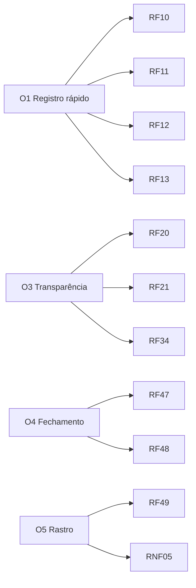

# 02 · Requisitos

> **Prioridade:** Essencial, Importante ou Desejável.
> **Protótipo:** Feito (visto no protótipo), Parcial ou Pendente (ainda não prototipado).

## Requisitos funcionais

### Acesso

| ID | Requisito | Prioridade | Protótipo |
|---|---|---|---|
| RF-01 | Login com e-mail e senha | Essencial | Feito |
| RF-02 | Bloquear a conta após 3 senhas erradas seguidas | Importante | Feito |
| RF-03 | Impedir login de usuário inativo, com mensagem clara | Essencial | Feito |
| RF-04 | Recuperar e trocar senha pelo próprio usuário | Importante | Feito (recuperação simulada) |
| RF-05 | Sair da sessão a qualquer momento | Essencial | Feito |

### Registro de ponto

| ID | Requisito | Prioridade | Protótipo |
|---|---|---|---|
| RF-10 | Mostrar relógio e os 4 registros do dia | Essencial | Feito |
| RF-11 | Destacar apenas o próximo registro válido | Essencial | Feito |
| RF-12 | Pedir confirmação antes de gravar | Importante | Feito |
| RF-13 | Emitir comprovante com número, data, hora e origem | Essencial | Feito |
| RF-14 | Mostrar horas trabalhadas e progresso da jornada do dia | Importante | Feito |
| RF-15 | Gravar a hora do servidor, não a do aparelho | Essencial | Pendente (simulada) |
| RF-16 | **Localização do aparelho obrigatória**: sem permissão, o botão de ponto normal fica bloqueado. O único caminho é o ponto sem localização (RF-74), que depende de aprovação | Essencial | Feito |
| RF-17 | Mostrar mapa com a posição da pessoa, círculo de precisão e a sede | Essencial | Feito (mapa esquemático) |
| RF-18 | Gravar latitude, longitude e precisão em cada batida e no comprovante | Essencial | Feito |
| RF-19 | Indicar se o registro foi dentro ou fora da área da empresa (apenas informativo) | Importante | Feito |

### Espelho de ponto

| ID | Requisito | Prioridade | Protótipo |
|---|---|---|---|
| RF-20 | Listar o mês dia a dia com batidas, total, saldo e situação | Essencial | Feito |
| RF-21 | Resumo do mês: horas, saldo, faltas, dias incompletos | Essencial | Feito |
| RF-22 | Escolher entre os últimos 3 meses | Importante | Feito |
| RF-23 | Destacar fins de semana e folgas | Desejável | Feito |
| RF-24 | Atalho "Ajustar" em dias com problema | Importante | Feito |

### Ajustes

| ID | Requisito | Prioridade | Protótipo |
|---|---|---|---|
| RF-30 | Solicitar ajuste com dia, tipo de batida, horário e justificativa | Essencial | Feito |
| RF-31 | Exigir justificativa com ao menos 10 caracteres | Importante | Feito |
| RF-32 | Gestor aprova ou recusa; recusa pede motivo | Essencial | Feito |
| RF-33 | Aprovação altera o espelho e marca a batida como "ajuste" | Essencial | Feito |
| RF-34 | Colaborador acompanha o status das solicitações | Importante | Feito |
| RF-35 | Notificar por e-mail quando houver decisão | Desejável | Pendente |

### Gestão e RH

| ID | Requisito | Prioridade | Protótipo |
|---|---|---|---|
| RF-40 | Gestor vê a equipe: quem está trabalhando, no intervalo, ausente | Essencial | Feito |
| RF-41 | Gestor abre o espelho de cada pessoa da equipe (leitura) | Importante | Feito |
| RF-42 | RH vê painel com presença agora, pendências e inconsistências | Importante | Feito |
| RF-43 | RH cadastra colaborador com perfil, gestor e jornada | Essencial | Feito |
| RF-44 | RH ativa/desativa usuário e redefine senha | Essencial | Feito |
| RF-45 | RH consulta modelos de jornada | Importante | Feito (leitura) |
| RF-46 | RH edita e cria jornadas | Importante | Parcial (criação pronta) |
| RF-47 | Relatório mensal por colaborador | Essencial | Feito |
| RF-48 | Exportar relatório em CSV e PDF | Importante | Parcial (CSV por cópia de texto) |
| RF-49 | Log de auditoria de ações sensíveis | Essencial | Feito |

### Requisitos adicionados pelo benchmark (Rodada 4)

Origem de cada um na [matriz de funcionalidades](10-matriz-de-funcionalidades.md).

| ID | Requisito | Prioridade | Protótipo |
|---|---|---|---|
| RF-50 | Ficha do colaborador com matrícula, CPF, setor, cargo, gestor, unidade, perfil, jornada, contrato, admissão, centro de custo, valor da hora e PIN | Essencial | Feito |
| RF-51 | RH gerencia setores, unidades, projetos e jornadas | Essencial | Feito |
| RF-52 | Quiosque compartilhado com matrícula e PIN | Importante | Feito |
| RF-53 | Validação facial com prova de vida obrigatória antes de toda batida (web, quiosque e ponto sem localização). Não pode ser desligada | Essencial | Parcial: simulada |
| RF-54 | Cerca virtual por unidade, raio configurável, e três modos para batida fora da cerca (permitir, justificar, bloquear) | Essencial | Feito |
| RF-55 | Alertar quando a batida vem de aparelho diferente do habitual | Importante | Feito |
| RF-56 | Registrar offline e sincronizar depois | Importante | Feito |
| RF-57 | Escolher projeto na entrada e gerar horas por projeto | Desejável | Feito |
| RF-58 | Alertas automáticos: atraso, saída antecipada, intervalo curto, mais de 6h sem pausa, hora extra acima do limite, jornada acima de 10h, interjornada menor que 11h | Essencial | Feito |
| RF-59 | Separar hora extra 50% e 100% e calcular adicional noturno | Essencial | Feito |
| RF-60 | Banco de horas com saldo e folga compensatória | Essencial | Feito |
| RF-61 | Calendário de feriados nacionais no cálculo | Essencial | Feito |
| RF-62 | Escala semanal com folga, plantão, férias e feriados | Importante | Feito |
| RF-63 | Ausências (férias, atestado, folga, licença, abono, troca) com aprovação e saldo de férias | Essencial | Feito |
| RF-64 | Espelho assinado pelo colaborador, aprovado pelo gestor e fechado pelo RH, com mês travado | Essencial | Feito |
| RF-65 | Painel de exceções para gestor e RH | Essencial | Feito |
| RF-66 | Relatórios: consolidado, extras, atrasos e faltas, banco de horas, projetos, localização, eventos de folha e AFD/AEJ | Essencial | Feito (AFD/AEJ em prévia) |
| RF-67 | Integrações com folha, chat, agenda, SSO e relógios físicos | Importante | Parcial: simuladas |
| RF-68 | Configurações de política de ponto, métodos de registro e segurança | Essencial | Feito |
| RF-69 | Mural de avisos por empresa ou setor | Desejável | Feito |
| RF-70 | Perfil com dados, QR Code, troca de senha e preferências de notificação | Importante | Feito |
| RF-71 | Ver o local de cada batida no espelho (gestor e RH) | Importante | Feito |
| RF-72 | Módulo opcional de custo de mão de obra (valor da hora, custo estimado e valores nos eventos de folha), desligado por padrão e visível só a RH e Admin | Desejável | Feito |
| RF-73 | Aviso de finalidade na captura da selfie e método alternativo (PIN ou QR) | Essencial | Parcial: aviso feito, alternativa no app |

### Ponto sem localização (Rodada 6)

| ID | Requisito | Prioridade | Protótipo |
|---|---|---|---|
| RF-74 | Sem a localização liberada, a pessoa pode **solicitar** o ponto sem localização. Ele **não é registrado** até o gestor aprovar | Essencial | Feito |
| RF-75 | A pessoa que bate **deve justificar** (mínimo 10 caracteres). A validação facial com prova de vida também é obrigatória | Essencial | Feito |
| RF-76 | O gestor recebe aviso na lista de pendências e no contador do menu, com a justificativa, o motivo técnico, o aparelho e a hora batida, **antes de decidir** | Essencial | Feito |
| RF-77 | O gestor **deve justificar** a aprovação ou a recusa (mínimo 10 caracteres). A decisão e as duas justificativas ficam no histórico e na auditoria | Essencial | Feito |
| RF-78 | Ponto aprovado entra no espelho marcado como "sem localização" e mostra quem aprovou e por quê. Recusado não entra | Essencial | Feito |
| RF-79 | Ninguém decide o próprio ponto. Para gestores, decidem RH e Admin | Essencial | Feito |
| RF-80 | Configuração para **bloquear** o ponto sem localização em vez de enviá-lo para aprovação | Importante | Feito |
| RF-81 | Prazo para o gestor decidir (padrão 2 dias úteis, configurável): lembrete no último dia e escalonamento ao RH quando vence | Importante | Feito |
| RF-82 | Cadastro facial com prova de vida obrigatório para cadastrar usuário. Sem ele o cadastro não é salvo | Essencial | Parcial: simulada |
| RF-83 | Prova de vida com desafios aleatórios (piscar, virar a cabeça, sorrir, abrir a boca) a cada tentativa | Essencial | Parcial: simulada |
| RF-84 | Rosto que não confere ou prova de vida reprovada impede a batida. Após 3 tentativas a validação bloqueia e a pessoa procura o RH. Cada recusa vai para a auditoria | Essencial | Feito |
| RF-85 | Usuário sem rosto cadastrado não bate o ponto e vê aviso para procurar o RH. O RH pode refazer o cadastro facial na edição | Essencial | Feito |
| RF-86 | Falha na validação facial (3 recusas), câmera indisponível ou cadastro facial pendente: a pessoa pode pedir a batida **sem validação facial**. Ela fica pendente, com justificativa dela e do gestor | Essencial | Feito |
| RF-87 | O RH pode autorizar **método alternativo** (PIN) a uma pessoa, sem registrar o motivo. Revisão a cada 180 dias, com aviso na ficha quando vencida | Essencial | Feito |
| RF-88 | Batidas aprovadas sem validação facial ou por método alternativo ficam marcadas no espelho (s/f, alt), na ficha do dia e nos alertas | Importante | Feito |
| RF-89 | Aviso ao colaborador sobre o tratamento do rosto, com alternativa sem necessidade de explicação | Essencial | Pendente: texto pronto em [docs/11](11-pacote-juridico-lgpd.md), tela no app real |
| RF-90 | Onboarding do cliente com o nome e o contato do encarregado (DPO) da empresa, exibidos no aviso ao colaborador | Essencial | Pendente: app real |

## Requisitos não funcionais

| ID | Requisito | Meta |
|---|---|---|
| RNF-01 | Funciona em celular e computador | Layout responsivo desde 360 px |
| RNF-02 | Desempenho | Tela de ponto carrega em menos de 2 s em 4G |
| RNF-03 | Segurança de senha | Armazenamento com hash forte, nunca em texto puro |
| RNF-04 | Sessão | Expira por inatividade (valor a definir) |
| RNF-05 | Integridade | Registros imutáveis; só ajuste com trilha |
| RNF-06 | Acessibilidade | Contraste AA, navegação por teclado, rótulos em formulários |
| RNF-07 | Tema | Claro e escuro conforme o sistema do usuário |
| RNF-08 | Privacidade | Seguir a LGPD: coletar só o necessário |
| RNF-09 | Disponibilidade | Meta inicial de 99,5% (a validar) |
| RNF-10 | Idioma | Português do Brasil, fuso America/Sao_Paulo |
| RNF-11 | Mapa real no app | Mapa com tiles (ex.: OpenStreetMap com Leaflet). O protótipo usa um desenho esquemático |
| RNF-12 | Contexto seguro | Geolocalização e câmera exigem HTTPS |
| RNF-13 | **Qualquer navegador e qualquer aparelho** | Funciona nas duas últimas versões de Chrome, Edge, Firefox, Safari e Samsung Internet, em Windows, macOS, Linux, Android e iOS, de 360 px de largura até telas grandes |
| RNF-14 | App web instalável (PWA) | Instalável na tela inicial, abre em tela cheia e tem o mesmo comportamento em todos os aparelhos |
| RNF-15 | Sem dependência de app nativo | Toda função da primeira versão roda no navegador. Câmera e GPS usam as permissões do próprio navegador |
| RNF-16 | Caminho alternativo quando o aparelho ou a câmera não permite | Ver [Q-20](08-perguntas-em-aberto.md) e [Q-22](08-perguntas-em-aberto.md) |
| RNF-17 | Template facial apagado no desligamento (até 30 dias) | Ver [docs/11](11-pacote-juridico-lgpd.md), seção 7 |
| RNF-18 | Nenhuma foto de batida guardada por padrão. Só o modelo matemático e o resultado | Minimização (LGPD art. 6, III) |
| RNF-19 | Gravar de imediato a marcação recebida, mesmo pendente, em registro imutável | Mitiga o risco da Portaria 671 (ver docs/11, seção 12) |
| RNF-20 | Multiempresa: cada cliente só acessa os próprios dados, com isolamento na base | Produto vendido como serviço ([Q-03](08-perguntas-em-aberto.md)) |

## Rastreabilidade rápida

| RNF-21 | Desafio de prova de vida sorteado, assinado e de validade curta, verificado no servidor | Impede replay e adulteração no aparelho |
| RNF-22 | Relatório de testes de fraude (foto, tela, vídeo, máscara, câmera virtual) e de viés antes de cada lançamento do leitor | Sem certificação independente ([docs/12](12-leitor-facial-proprio.md)) |
| RNF-23 | Licença de cada modelo e biblioteca facial verificada para uso comercial | Evitar modelos restritos a pesquisa |
