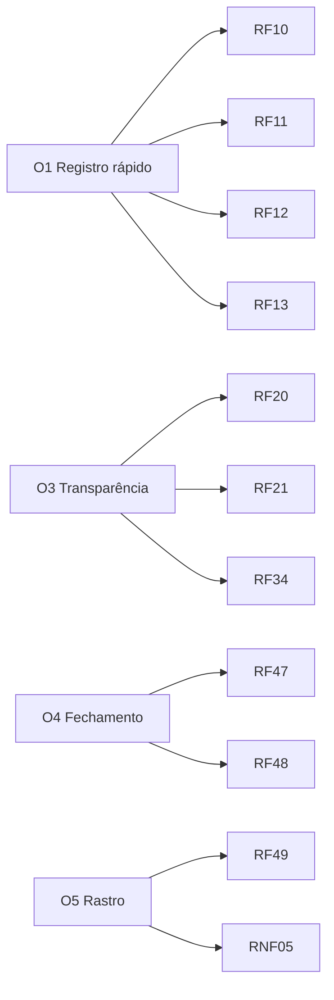

# 02 · Requisitos

> **Legenda de prioridade:** 🔴 Essencial · 🟡 Importante · 🟢 Desejável
> **Legenda de validação:** ✅ visto no protótipo · 🟡 parcial · ⬜ ainda não prototipado

## Requisitos funcionais

### Acesso

| ID | Requisito | Prioridade | Protótipo |
|---|---|---|---|
| RF-01 | Login com e-mail e senha | 🔴 | ✅ |
| RF-02 | Bloquear a conta após 3 senhas erradas seguidas | 🟡 | ✅ |
| RF-03 | Impedir login de usuário inativo, com mensagem clara | 🔴 | ✅ |
| RF-04 | Recuperar e trocar senha pelo próprio usuário | 🟡 | ⬜ |
| RF-05 | Sair da sessão a qualquer momento | 🔴 | ✅ |

### Registro de ponto

| ID | Requisito | Prioridade | Protótipo |
|---|---|---|---|
| RF-10 | Mostrar relógio e os 4 registros do dia | 🔴 | ✅ |
| RF-11 | Destacar apenas o próximo registro válido | 🔴 | ✅ |
| RF-12 | Pedir confirmação antes de gravar | 🟡 | ✅ |
| RF-13 | Emitir comprovante com número, data, hora e origem | 🔴 | ✅ |
| RF-14 | Mostrar horas trabalhadas e progresso da jornada do dia | 🟡 | ✅ |
| RF-15 | Gravar a hora do servidor, não a do aparelho | 🔴 | ⬜ (simulada) |
| RF-16 | **Localização do aparelho obrigatória**: sem permissão, os botões de ponto ficam bloqueados | 🔴 | ✅ |
| RF-17 | Mostrar mapa com a posição da pessoa, círculo de precisão e a sede | 🔴 | ✅ (mapa esquemático) |
| RF-18 | Gravar latitude, longitude e precisão em cada batida e no comprovante | 🔴 | ✅ |
| RF-19 | Indicar se o registro foi dentro ou fora da área da empresa (apenas informativo) | 🟡 | ✅ |

### Espelho de ponto

| ID | Requisito | Prioridade | Protótipo |
|---|---|---|---|
| RF-20 | Listar o mês dia a dia com batidas, total, saldo e situação | 🔴 | ✅ |
| RF-21 | Resumo do mês: horas, saldo, faltas, dias incompletos | 🔴 | ✅ |
| RF-22 | Escolher entre os últimos 3 meses | 🟡 | ✅ |
| RF-23 | Destacar fins de semana e folgas | 🟢 | ✅ |
| RF-24 | Atalho "Ajustar" em dias com problema | 🟡 | ✅ |

### Ajustes

| ID | Requisito | Prioridade | Protótipo |
|---|---|---|---|
| RF-30 | Solicitar ajuste com dia, tipo de batida, horário e justificativa | 🔴 | ✅ |
| RF-31 | Exigir justificativa com ao menos 10 caracteres | 🟡 | ✅ |
| RF-32 | Gestor aprova ou recusa; recusa pede motivo | 🔴 | ✅ |
| RF-33 | Aprovação altera o espelho e marca a batida como "ajuste" | 🔴 | ✅ |
| RF-34 | Colaborador acompanha o status das solicitações | 🟡 | ✅ |
| RF-35 | Notificar por e-mail quando houver decisão | 🟢 | ⬜ |

### Gestão e RH

| ID | Requisito | Prioridade | Protótipo |
|---|---|---|---|
| RF-40 | Gestor vê a equipe: quem está trabalhando, no intervalo, ausente | 🔴 | ✅ |
| RF-41 | Gestor abre o espelho de cada pessoa da equipe (leitura) | 🟡 | ✅ |
| RF-42 | RH vê painel com presença agora, pendências e inconsistências | 🟡 | ✅ |
| RF-43 | RH cadastra colaborador com perfil, gestor e jornada | 🔴 | ✅ |
| RF-44 | RH ativa/desativa usuário e redefine senha | 🔴 | ✅ |
| RF-45 | RH consulta modelos de jornada | 🟡 | ✅ (leitura) |
| RF-46 | RH edita e cria jornadas | 🟡 | ⬜ |
| RF-47 | Relatório mensal por colaborador | 🔴 | ✅ |
| RF-48 | Exportar relatório em CSV e PDF | 🟡 | ⬜ |
| RF-49 | Log de auditoria de ações sensíveis | 🔴 | ✅ |

## Requisitos não funcionais

| ID | Requisito | Meta |
|---|---|---|
| RNF-01 | Funciona em celular e computador | Layout responsivo desde 360 px |
| RNF-02 | Desempenho | Tela de ponto carrega em menos de 2 s em 4G |
| RNF-03 | Segurança de senha | Armazenamento com hash forte, nunca em texto puro |
| RNF-04 | Sessão | Expira por inatividade (valor a definir) |
| RNF-05 | Integridade | Registros imutáveis; só ajuste com trilha |
| RNF-06 | Acessibilidade | Contraste AA, navegação por teclado, rótulos em formulários |
| RNF-07 | Tema | Claro e escuro conforme o sistema do usuário |
| RNF-08 | Privacidade | Seguir a LGPD: coletar só o necessário |
| RNF-09 | Disponibilidade | Meta inicial de 99,5% (a validar) |
| RNF-10 | Idioma | Português do Brasil, fuso America/Sao_Paulo |
| RNF-11 | Mapa real no app | Mapa com tiles (ex.: OpenStreetMap com Leaflet). O protótipo usa um desenho esquemático |
| RNF-12 | Contexto seguro | Geolocalização exige HTTPS |

## Rastreabilidade rápida

