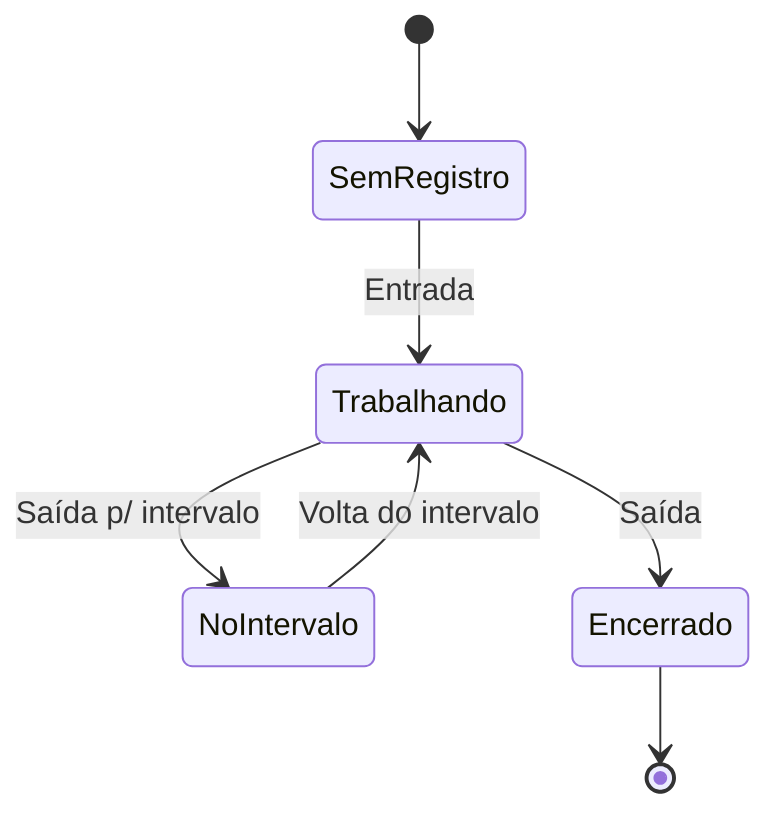
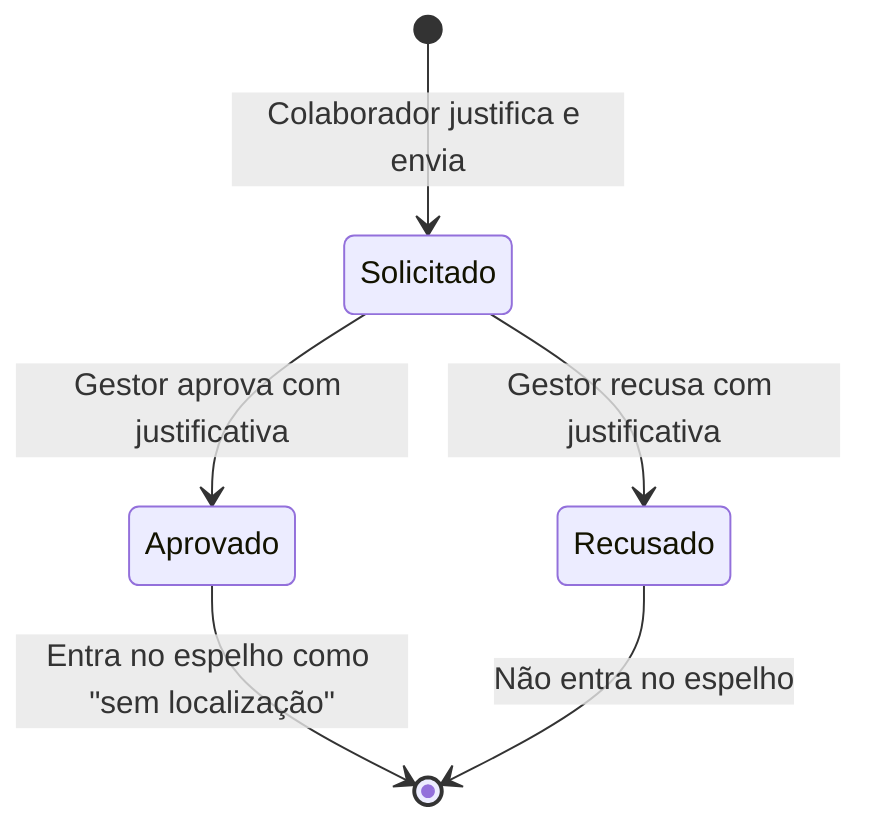
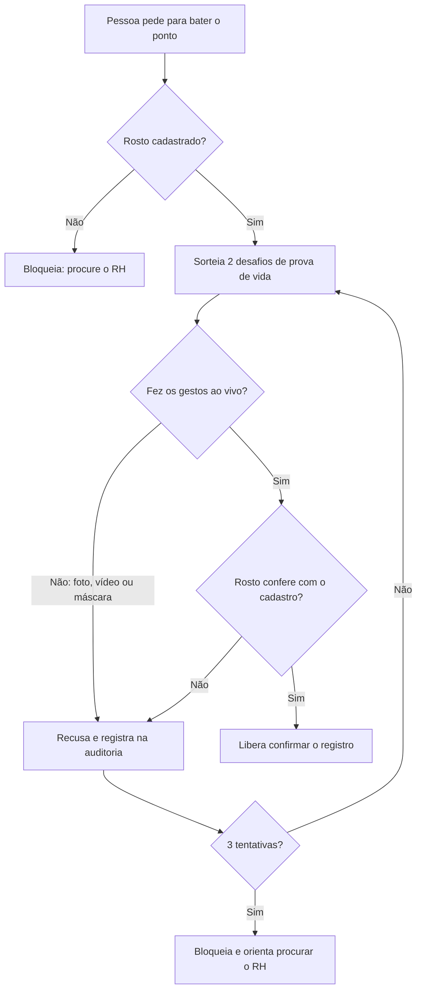
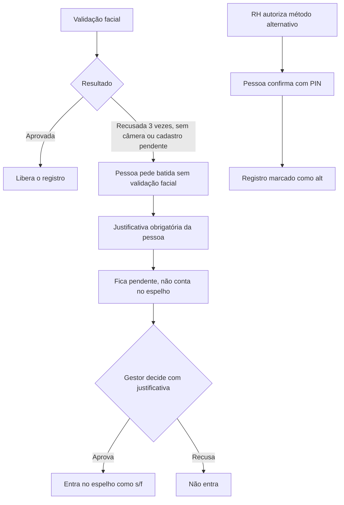
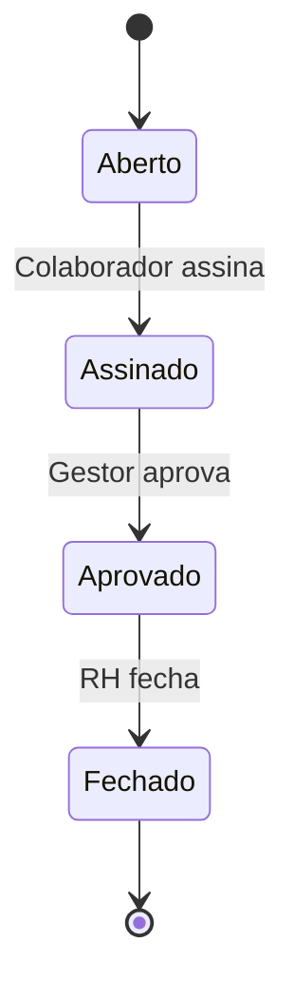

# 03 · Regras de negócio

> Estas regras estão implementadas no protótipo e servem de base para a especificação do app real.

## RN-01 · Sequência de batidas

Cada dia aceita as batidas em ordem fixa. O sistema só habilita a próxima.



Jornadas sem intervalo (ex.: Estágio 4h) usam só **Entrada** e **Saída**.

## RN-10 · Localização obrigatória

1. O sistema pede a localização do aparelho ao abrir "Registrar ponto".
2. **Sem permissão, a batida normal não é aceita.** O botão do próximo registro fica desabilitado com o texto "Localização necessária". O único caminho é o ponto sem localização (RN-19).
3. O mapa mostra a posição, a precisão (círculo) e a sede da empresa.
4. A batida grava latitude, longitude e precisão. O comprovante repete esses dados.
5. Estar **fora da área da empresa** (raio de 200 m no protótipo) não bloqueia: apenas é informado. Se vira bloqueio ou sinalização ao gestor, está em [Q-04](08-perguntas-em-aberto.md).
6. O pedido de confirmação mostra o mapa de novo antes de gravar.
7. Se a permissão for retirada entre abrir a tela e confirmar, a batida é recusada.

## RN-02 · Cálculo de horas trabalhadas

```text
trabalhado = (saída_intervalo − entrada) + (saída − volta_intervalo)
```

Para jornada sem intervalo: `saída − entrada`.

## RN-03 · Saldo do dia

```text
saldo = trabalhado − jornada_esperada
```

O saldo só é calculado em dias **completos**. Dias incompletos ou com falta não entram no saldo até serem resolvidos.

## RN-04 · Situação do dia

| Situação | Quando |
|---|---|
| **Completo** | Todas as batidas da jornada registradas |
| **Em andamento** | Hoje, com ao menos uma batida e jornada aberta |
| **Sem registro** | Hoje, ainda sem batidas |
| **Incompleto** | Dia passado com batidas faltando |
| **Falta** | Dia útil passado sem nenhuma batida |
| **Folga** | Sábado ou domingo sem batidas |
| **Ajuste pendente** | Existe solicitação aguardando o gestor naquele dia |

## RN-05 · Modelos de jornada

| Jornada | Esperado/dia | Intervalo | Horário de referência |
|---|---|---|---|
| Comercial 8h | 08:00 | 1h | 09:00–18:00 |
| Reduzida 6h | 06:00 | 15 min | 08:00–14:00 |
| Estágio 4h | 04:00 | nenhum | 13:00–17:00 |

## RN-06 · Ajustes

1. Só o próprio colaborador solicita ajuste do próprio ponto.
2. Dia do ajuste não pode ser futuro.
3. Justificativa obrigatória (mínimo 10 caracteres).
4. Quem aprova: o **gestor direto** do colaborador. RH e Administrador também podem decidir.
5. Ao aprovar, a batida é criada ou substituída e marcada como origem `ajuste`.
6. Ao recusar, o motivo é guardado e mostrado ao colaborador.
7. Toda solicitação e decisão entra na auditoria.

## RN-07 · Acesso e bloqueio

- Usuário **inativo** não entra.
- **3 senhas erradas seguidas** bloqueiam a conta até o RH redefinir a senha.
- Mensagem de erro não revela se o e-mail existe.

## RN-08 · Permissões

| Ação | Colaborador | Gestor | RH | Admin |
|---|:-:|:-:|:-:|:-:|
| Registrar o próprio ponto | Sim | Sim | Sim | Sim |
| Ver o próprio espelho, escala e ausências | Sim | Sim | Sim | Sim |
| Solicitar ajuste e ausência | Sim | Sim | Sim | Sim |
| Assinar o próprio espelho | Sim | Sim | Sim | Sim |
| Ver espelho, ficha e local da equipe | Não | Sim (só equipe) | Sim | Sim |
| Aprovar ajustes, ausências e espelhos | Não | Sim (só equipe) | Sim | Sim |
| Alterar escala | Não | Sim (só equipe) | Sim | Sim |
| Painel de exceções | Não | Sim (só equipe) | Sim | Sim |
| Publicar aviso no mural | Não | Sim | Sim | Sim |
| Cadastrar e editar colaboradores | Não | Não | Sim | Sim |
| Setores, unidades, projetos e jornadas | Não | Não | Sim | Sim |
| Fechar o mês | Não | Não | Sim | Sim |
| Relatórios, integrações e auditoria | Não | Não | Sim | Sim |
| Configurações de ponto | Não | Não | Sim | Sim |
| Configurações de segurança | Não | Não | Não | Sim |

## RN-09 · Imutabilidade

Um registro de ponto nunca é editado nem apagado. Mudanças acontecem por ajuste aprovado, com data, autor e justificativa.

## RN-19 · Ponto sem localização



1. Só aparece quando a localização não foi liberada e a configuração permite (padrão). Em modo **bloquear**, não há alternativa.
2. O colaborador informa uma **justificativa obrigatória** (mínimo 10 caracteres). A validação facial com prova de vida (RN-20) é obrigatória também.
3. O sistema guarda a **hora em que a pessoa bateu**, o motivo técnico (permissão negada, sem resposta, não liberada) e o aparelho.
4. O ponto fica **pendente e não conta** em horas, saldo, banco de horas nem relatórios de jornada até ser aprovado.
5. A batida pendente ocupa o lugar na sequência do dia: o botão mostra "aguardando gestor" e a pessoa segue para a próxima batida normalmente.
6. Aprovam o **gestor direto**, RH e Admin. Ninguém aprova o próprio ponto. Para gestores, decidem RH e Admin.
7. O aprovador vê, antes de decidir, a justificativa, o motivo técnico, o aparelho e a hora, e **precisa justificar** a decisão (mínimo 10 caracteres).
8. Aprovado: a batida entra no espelho com a hora original, marcada "sem localização", com a justificativa da pessoa e a do gestor. Recusado: não entra, e o dia pode virar "marcação ímpar" para ajuste.
9. Mês fechado não aceita decisão.
10. Tudo vai para a auditoria e para o relatório de localização (como aprovado ou pendente).
11. **Prazo de decisão:** 2 dias úteis a partir do pedido (configurável de 1 a 10). No último dia o gestor recebe lembrete. Vencido o prazo, o pedido é marcado como **escalado ao RH**, que passa a ser o responsável, sem tirar o direito do gestor de decidir. Não existe prazo legal específico para isso; 2 dias úteis é a prática comum de fluxos de aprovação de ponto e deve caber antes do fechamento do mês.
12. **Sem limite mensal** de pedidos por pessoa (decisão da AxSys). O controle de abuso fica na justificativa obrigatória, na aprovação do gestor e no relatório de localização, que mostra quem usa esse caminho com frequência.

## RN-20 · Validação facial com prova de vida



1. A validação vem **antes** de confirmar o registro. Sem ela aprovada, o botão de confirmar não grava nada.
2. Vale para o navegador, o quiosque e o ponto sem localização. Não há opção de desligar.
3. Os desafios são sorteados a cada tentativa, para impedir foto, vídeo e máscara.
4. Falha na prova de vida ou rosto que não confere conta como tentativa. Com 3 tentativas falhas a validação bloqueia e a pessoa procura o RH ou o gestor. Cada recusa vai para a auditoria.
5. **Cadastro:** não é possível criar usuário sem cadastrar o rosto com prova de vida. O RH pode refazer o cadastro na edição do colaborador. Usuário sem rosto cadastrado não consegue bater o ponto.
6. O comprovante registra "validação facial com prova de vida aprovada" e a similaridade.
7. No protótipo a câmera é simulada: os botões "fiz o gesto", "foto ou vídeo" e "outra pessoa" permitem testar cada resultado. No app real a prova de vida e a comparação facial precisam de um serviço próprio (Q-22).
8. **Leitor próprio:** a prova de vida é desenvolvida pela AxSys. O servidor sorteia e verifica o desafio, e o resultado é registrado com a versão do leitor. Requisitos e testes de fraude em [docs/12](12-fornecedores-prova-de-vida.md), seção 7.
9. **LGPD:** com a validação obrigatória, o dado biométrico deixa de ser opcional. O parecer jurídico da Q-13 passa a ser requisito para o lançamento.

## RN-21 · Exceções à validação facial



1. A exceção usa o **mesmo fluxo e o mesmo prazo** do ponto sem localização (RN-19): justificativa dos dois lados, 2 dias úteis, escalonamento ao RH, ninguém decide o próprio ponto.
2. A batida aprovada entra com a **localização real** que a pessoa tinha na hora e a marca **s/f**.
3. **Método alternativo:** o RH autoriza por pessoa, na edição do colaborador. **O motivo não é registrado**, para não tratar dado de saúde. A autorização vale 180 dias e depois pede revisão; a ficha avisa quando vencida.
4. Com método alternativo, a batida pede o PIN de 4 dígitos. Três PINs errados bloqueiam a tentativa. A batida fica marcada **alt**.
5. A pessoa pode pedir o método alternativo sem explicar o motivo (aviso ao colaborador, [docs/11](11-pacote-juridico-lgpd.md)).
6. Toda exceção e autorização vai para a auditoria.

## RN-11 · Alertas de jornada (CLT)

Calculados automaticamente para cada dia, com os valores de Configurações:

| Alerta | Condição |
|---|---|
| Atraso | Entrada depois do horário previsto mais a tolerância |
| Saída antecipada | Saída antes do fim previsto menos a tolerância |
| Intervalo curto | Intervalo menor que o mínimo (padrão 60 min) |
| Sem intervalo | Mais de 6h seguidas antes da saída para o intervalo |
| Hora extra alta | Saldo do dia acima do limite (padrão 2h) |
| Jornada longa | Mais de 10h trabalhadas |
| Interjornada | Menos de 11h entre a saída de um dia e a entrada do seguinte |
| Marcação ímpar | Dia passado com batidas faltando |
| Falta | Dia útil passado sem batidas, sem ausência aprovada e sem ajuste pendente |

## RN-12 · Horas extras e adicional noturno

- Em dia normal, o saldo positivo do dia conta como **extra 50%**.
- Em folga, fim de semana ou feriado, todas as horas trabalhadas contam como **extra 100%**.
- Horas entre 22:00 e 05:00 geram **adicional noturno** (20% no relatório de folha).
- Custo estimado = horas × valor da hora, com acréscimo de 50% ou 100% nas extras.

## RN-13 · Banco de horas

`banco = soma dos saldos dos dias completos − folgas compensatórias aprovadas`

Folga compensatória aprovada desconta a jornada do dia. A validade (padrão 6 meses) é uma configuração; o vencimento automático fica para o app.

## RN-14 · Feriados e escala

1. Feriados nacionais não geram falta nem esperam jornada.
2. A escala padrão vem da jornada. O gestor pode marcar **folga** em dia útil ou **plantão** em fim de semana e feriado.
3. Ausência aprovada (férias, atestado, licença, folga, abono) aparece na escala e dispensa o ponto no dia.

## RN-15 · Ausências

- Tipos: férias, atestado, folga compensatória, licença, abono e troca de turno.
- Quem aprova: gestor direto (RH e Admin também).
- Férias: 30 dias por ano. Não pode pedir mais que o saldo.
- Não pode haver dois pedidos no mesmo período.

## RN-16 · Fechamento do mês



- Só é possível assinar depois do fim do mês.
- Mês **fechado** não aceita novos ajustes nem decisões sobre ajustes daquele mês.

## RN-17 · Batida fora da área da empresa

A cerca é o raio configurado ao redor da unidade do colaborador. Quem trabalha em unidade sem cerca (home office) nunca está "fora".

| Modo | Efeito |
|---|---|
| Permitir e sinalizar | Registra e avisa o gestor |
| Exigir justificativa (padrão) | Pede o motivo, registra e avisa o gestor |
| Bloquear | Impede o registro |

## RN-18 · Verificação da batida

1. **Localização** obrigatória (RN-10).
2. **Validação facial com prova de vida** a cada batida, sempre ativa (RN-20).
3. **Aparelho:** batida em aparelho diferente do habitual gera alerta.
4. **Offline:** se permitido, a batida fica salva no aparelho como "aguardando sincronização" e é enviada quando a conexão volta. Se não for permitido, a batida é bloqueada.
5. **Janela de entrada:** se configurada, a entrada só é liberada a partir de X minutos antes do horário.
6. **Quiosque:** exige matrícula e PIN; a localização é a da unidade do aparelho.
