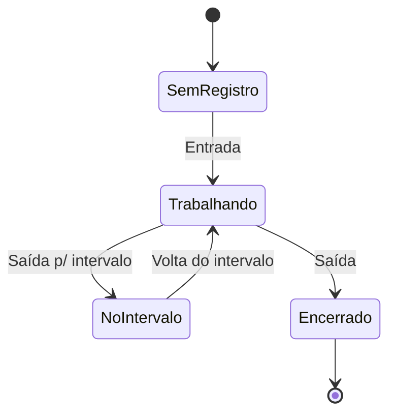

# 03 · Regras de negócio

> Estas regras estão implementadas no protótipo e servem de base para a especificação do app real.

## RN-01 · Sequência de batidas

Cada dia aceita as batidas em ordem fixa. O sistema só habilita a próxima.



Jornadas sem intervalo (ex.: Estágio 4h) usam só **Entrada** e **Saída**.

## RN-10 · Localização obrigatória

1. O sistema pede a localização do aparelho ao abrir "Registrar ponto".
2. **Sem permissão, nenhuma batida é aceita.** O botão do próximo registro fica desabilitado com o texto "Localização necessária".
3. O mapa mostra a posição, a precisão (círculo) e a sede da empresa.
4. A batida grava latitude, longitude e precisão. O comprovante repete esses dados.
5. Estar **fora da área da empresa** (raio de 200 m no protótipo) não bloqueia: apenas é informado. Se vira bloqueio ou sinalização ao gestor, está em [Q-04](08-perguntas-em-aberto.md).
6. O pedido de confirmação mostra o mapa de novo antes de gravar.
7. Se a permissão for retirada entre abrir a tela e confirmar, a batida é recusada.

## RN-02 · Cálculo de horas trabalhadas

```text
trabalhado = (saída_intervalo − entrada) + (saída − volta_intervalo)
```

Para jornada sem intervalo: `saída − entrada`.

## RN-03 · Saldo do dia

```text
saldo = trabalhado − jornada_esperada
```

O saldo só é calculado em dias **completos**. Dias incompletos ou com falta não entram no saldo até serem resolvidos.

## RN-04 · Situação do dia

| Situação | Quando |
|---|---|
| **Completo** | Todas as batidas da jornada registradas |
| **Em andamento** | Hoje, com ao menos uma batida e jornada aberta |
| **Sem registro** | Hoje, ainda sem batidas |
| **Incompleto** | Dia passado com batidas faltando |
| **Falta** | Dia útil passado sem nenhuma batida |
| **Folga** | Sábado ou domingo sem batidas |
| **Ajuste pendente** | Existe solicitação aguardando o gestor naquele dia |

## RN-05 · Modelos de jornada

| Jornada | Esperado/dia | Intervalo | Horário de referência |
|---|---|---|---|
| Comercial 8h | 08:00 | 1h | 09:00–18:00 |
| Reduzida 6h | 06:00 | 15 min | 08:00–14:00 |
| Estágio 4h | 04:00 | nenhum | 13:00–17:00 |

## RN-06 · Ajustes

1. Só o próprio colaborador solicita ajuste do próprio ponto.
2. Dia do ajuste não pode ser futuro.
3. Justificativa obrigatória (mínimo 10 caracteres).
4. Quem aprova: o **gestor direto** do colaborador. RH e Administrador também podem decidir.
5. Ao aprovar, a batida é criada ou substituída e marcada como origem `ajuste`.
6. Ao recusar, o motivo é guardado e mostrado ao colaborador.
7. Toda solicitação e decisão entra na auditoria.

## RN-07 · Acesso e bloqueio

- Usuário **inativo** não entra.
- **3 senhas erradas seguidas** bloqueiam a conta até o RH redefinir a senha.
- Mensagem de erro não revela se o e-mail existe.

## RN-08 · Permissões

| Ação | Colaborador | Gestor | RH | Admin |
|---|:-:|:-:|:-:|:-:|
| Registrar o próprio ponto | ✅ | ✅ | ✅ | ✅ |
| Ver o próprio espelho | ✅ | ✅ | ✅ | ✅ |
| Solicitar ajuste | ✅ | ✅ | ✅ | ✅ |
| Ver espelho da equipe | ❌ | ✅ (só equipe) | ✅ | ✅ |
| Aprovar ajustes | ❌ | ✅ (só equipe) | ✅ | ✅ |
| Cadastrar e desativar usuários | ❌ | ❌ | ✅ | ✅ |
| Relatórios e auditoria | ❌ | ❌ | ✅ | ✅ |

## RN-09 · Imutabilidade

Um registro de ponto nunca é editado nem apagado. Mudanças acontecem por ajuste aprovado, com data, autor e justificativa.
