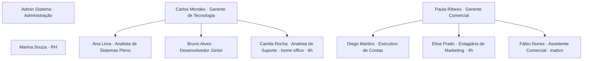

# 04 · Perfis, cadastro e usuários fictícios

> **Somente para o protótipo.** Estes usuários, senhas e PINs são genéricos, públicos neste repositório privado e **não devem existir no sistema real**.

## Perfis

| Perfil | Papel | Entra direto em |
|---|---|---|
| Administrador | Configura o sistema, incluindo segurança, e faz tudo que o RH faz | Visão geral |
| RH | Cadastra pessoas e organização, fecha o mês, emite relatórios | Visão geral |
| Gestor | Acompanha a equipe, aprova ajustes, ausências e espelhos, monta escalas | Minha equipe |
| Colaborador | Bate ponto, confere o espelho, pede ajustes e ausências | Registrar ponto |

## Ficha do colaborador

Todo colaborador tem estes dados, visíveis na ficha e editáveis pelo RH:

| Grupo | Campos |
|---|---|
| Identificação | Nome, matrícula, CPF (mascarado), e-mail, telefone |
| Organização | **Setor**, **cargo**, **gestor direto**, **unidade de trabalho**, perfil |
| Contrato | Tipo (CLT, Estágio, PJ, Temporário), data de admissão, jornada, centro de custo, valor da hora (só com o módulo de custo ligado) |
| Acesso | Senha, PIN do quiosque, aparelho habitual, situação (ativo ou inativo) |
| Indicadores | Banco de horas, dias de férias disponíveis |

## Estrutura organizacional fictícia

| Setor | Gestor | Pessoas |
|---|---|---|
| Tecnologia | Carlos Mendes | Ana, Bruno, Camila |
| Comercial | Paula Ribeiro | Diego, Elisa, Fábio (inativo) |
| Recursos Humanos | | Marina Souza |
| Administração | | Admin Sistema |

| Unidade | Local | Cerca virtual |
|---|---|---|
| Sede São Paulo | Av. Paulista (exemplo) | Raio de 200 m |
| Filial Rio de Janeiro | Centro (exemplo) | Raio de 200 m |
| Home office | — | Sem cerca |

## Contas de teste

| Nome | Cargo | Setor | Unidade | E-mail | Senha | Matrícula | PIN |
|---|---|---|---|---|---|---|---|
| Admin Sistema | Administrador de Sistemas | Administração | SP | `admin@axsys.test` | `Admin@123` | AX-0001 | 1111 |
| Marina Souza | Analista de RH Sênior | Recursos Humanos | SP | `rh.marina@axsys.test` | `Rh@12345` | AX-0002 | 2222 |
| Carlos Mendes | Gerente de Tecnologia | Tecnologia | SP | `gestor.carlos@axsys.test` | `Gestor@123` | AX-0003 | 3333 |
| Paula Ribeiro | Gerente Comercial | Comercial | RJ | `gestora.paula@axsys.test` | `Gestor@123` | AX-0004 | 4444 |
| Ana Lima | Analista de Sistemas Pleno | Tecnologia | SP | `ana.lima@axsys.test` | `Func@1234` | AX-0005 | 5555 |
| Bruno Alves | Desenvolvedor Júnior | Tecnologia | SP | `bruno.alves@axsys.test` | `Func@1234` | AX-0006 | 6666 |
| Camila Rocha | Analista de Suporte | Tecnologia | Home office | `camila.rocha@axsys.test` | `Func@1234` | AX-0007 | 7777 |
| Diego Martins | Executivo de Contas | Comercial | RJ | `diego.martins@axsys.test` | `Func@1234` | AX-0008 | 8888 |
| Elisa Prado | Estagiária de Marketing | Comercial | RJ | `elisa.prado@axsys.test` | `Func@1234` | AX-0009 | 9999 |
| Fábio Nunes | Assistente Comercial | Comercial | RJ | `fabio.nunes@axsys.test` | `Func@1234` | AX-0010 | 1010 |

## Cenários de teste já preparados nos dados

Datas são sempre relativas a hoje, contadas em dias úteis.

| Cenário | Onde ver | O que testar |
|---|---|---|
| Esqueceu de bater a saída | Ana, 2 dias úteis atrás | Dia "Incompleto", ajuste pendente para o Carlos aprovar |
| Falta | Bruno, 4 dias úteis atrás | Falta no espelho e abono pendente para o Carlos |
| Só a entrada registrada | Diego, 1 dia útil atrás | Ajuste pendente para a Paula |
| Atraso | Ana, 7 dias úteis atrás | Alerta de atraso e saldo negativo |
| Hora extra acima do limite | Bruno, 6 dias úteis atrás | Alerta e painel de exceções |
| Intervalo curto | Diego, 5 dias úteis atrás | Alerta de intervalo menor que 60 min |
| Ponto sem localização pendente | Elisa, saída de 1 dia útil atrás | Paula vê o aviso em Aprovações, lê a justificativa e decide com justificativa |
| Bater sem localização | Ana, simulador "Negar permissão" | Validação facial com prova de vida e justificativa obrigatórias; o ponto vira pendente para o Carlos |
| Atestado aprovado | Elisa, 8 dias úteis atrás | Dia "Atestado" no espelho e na escala |
| Férias aprovadas | Camila, daqui a 10 dias | Escala e calendário de ausências |
| Férias pendentes | Ana, daqui a 45 dias | Aprovação do Carlos e saldo de férias |
| Folga compensatória pendente | Diego, próxima semana | Aprovação da Paula e banco de horas |
| Espelho do mês anterior em estágios diferentes | Ana assinou, Bruno aprovado, Camila fechado, Diego sem assinar | Fluxo de fechamento |
| Home office | Camila | Sem cerca virtual; nunca "fora da área" |
| Batida fora da área | Ana usando o simulador "Home office" | Justificativa obrigatória |
| Aparelho diferente | Simulador "Outro aparelho" | Alerta para o gestor |
| Registro offline | Simulador "Sem internet" | Batida aguardando sincronização |
| Usuário inativo | Fábio | Mensagem no login |
| Bloqueio por senha | Qualquer conta | Errar 3 vezes; RH redefine em Colaboradores |
| Jornada sem intervalo | Elisa | Só duas batidas |
| Quiosque | Login > Abrir modo quiosque | Matrícula e PIN da tabela acima |

## Dicas de uso

- Na tela de login o botão **Usar** preenche e-mail e senha.
- **Reiniciar dados** volta tudo ao estado inicial.
- O dia da semana de hoje muda o que aparece. Em fim de semana todos estão de folga; teste em dia útil para ver atrasos e presença.
