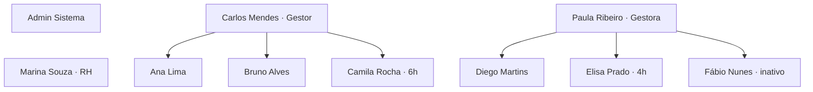

# 04 · Perfis e usuários fictícios

> ⚠️ **Somente para o protótipo.** Estes usuários e senhas são genéricos, públicos neste repositório privado e **não devem existir no sistema real**.

## Perfis

| Perfil | Papel | Entra direto em |
|---|---|---|
| Administrador | Configura o sistema e faz tudo que o RH faz | Visão geral |
| RH | Cadastra pessoas, acompanha presença e fecha o mês | Visão geral |
| Gestor | Acompanha a equipe e aprova ajustes | Minha equipe |
| Colaborador | Bate ponto e confere o espelho | Registrar ponto |

## Contas de teste

| Nome | E-mail | Senha | Perfil | Jornada | Gestor | Situação |
|---|---|---|---|---|---|---|
| Admin Sistema | `admin@axsys.test` | `Admin@123` | Administrador | Comercial 8h | — | Ativo |
| Marina Souza | `rh.marina@axsys.test` | `Rh@12345` | RH | Comercial 8h | — | Ativo |
| Carlos Mendes | `gestor.carlos@axsys.test` | `Gestor@123` | Gestor | Comercial 8h | — | Ativo |
| Paula Ribeiro | `gestora.paula@axsys.test` | `Gestor@123` | Gestor | Comercial 8h | — | Ativo |
| Ana Lima | `ana.lima@axsys.test` | `Func@1234` | Colaborador | Comercial 8h | Carlos | Ativo |
| Bruno Alves | `bruno.alves@axsys.test` | `Func@1234` | Colaborador | Comercial 8h | Carlos | Ativo |
| Camila Rocha | `camila.rocha@axsys.test` | `Func@1234` | Colaborador | Reduzida 6h | Carlos | Ativo |
| Diego Martins | `diego.martins@axsys.test` | `Func@1234` | Colaborador | Comercial 8h | Paula | Ativo |
| Elisa Prado | `elisa.prado@axsys.test` | `Func@1234` | Colaborador | Estágio 4h | Paula | Ativo |
| Fábio Nunes | `fabio.nunes@axsys.test` | `Func@1234` | Colaborador | Comercial 8h | Paula | **Inativo** |

## Organograma fictício

## Cenários de teste já preparados nos dados

| Cenário | Onde ver | O que testar |
|---|---|---|
| Esqueceu de bater a saída | Ana, 3 dias úteis atrás | Dia "Incompleto" e ajuste pendente de Ana para o Carlos aprovar |
| Falta | Bruno, 5 dias úteis atrás | Dia "Falta" no espelho e contagem em relatórios |
| Só a entrada registrada | Diego, 2 dias úteis atrás | Ajuste pendente de Diego para a Paula |
| Atraso | Ana, 9 dias úteis atrás | Entrada tarde e saldo negativo |
| Dia em andamento | Bruno, Camila, Diego e Elisa, hoje (dias úteis) | Painel da equipe com status diferentes |
| Usuário inativo | Fábio | Mensagem de conta inativa no login |
| Bloqueio por senha | Qualquer conta | Errar a senha 3 vezes; RH redefine em Colaboradores |
| Jornada sem intervalo | Elisa | Só duas batidas na tela de ponto |

## Dica de uso

Na tela de login do protótipo, o botão **Usar** preenche e-mail e senha da conta escolhida. O botão **Reiniciar dados do protótipo** volta tudo ao estado inicial.
