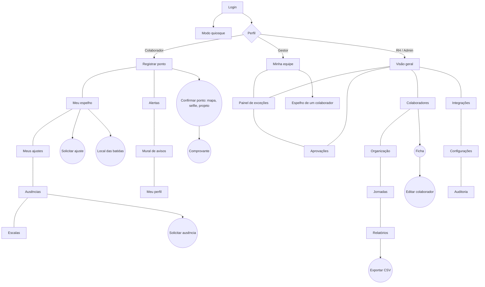

# 05 · Páginas e layout

> Fonte da verdade visual: [`prototipo/index.html`](../prototipo/index.html)

## Mapa de telas

## Estrutura geral

| Elemento | Comportamento |
|---|---|
| **Barra lateral** | Navegação em seções por perfil: Meu ponto, Gestão, RH, Conta. No celular vira uma faixa no topo |
| **Área principal** | Título, subtítulo, ações à direita, depois cartões |
| **Modais** | Para ações curtas. Fecham com Esc ou clique fora |
| **Aviso (toast)** | Confirma resultados em 3 segundos |
| **Tema** | Claro e escuro automáticos |

## Telas

### Login e quiosque
- **Login:** painel de apresentação e formulário. Links para recuperar senha e abrir o quiosque. Lista de usuários de teste com matrícula e PIN.
- **Quiosque:** relógio grande, escolha da unidade do aparelho, matrícula e PIN. A confirmação mostra mapa e pede selfie quando ativa.

### Registrar ponto (todos)
- **Relógio grande** com hora legal.
- **Cartão de localização** com mapa, precisão, coordenadas e área da empresa. Sem permissão, os botões de ponto ficam bloqueados.
- **Quatro botões** de batida: feito (verde), próximo (destacado), futuros (desabilitados).
- **Confirmação** com mapa, selfie, projeto (na entrada), justificativa se estiver fora da área, e avisos de aparelho diferente e de modo offline.
- Cartões laterais: Hoje (progresso e previsão de saída), banco de horas e férias, últimos dias, mural de avisos.
- Faixa de alerta com botão **Sincronizar agora** quando houver batidas offline.

### Meu espelho
- Fechamento do mês: situação (Aberto, Assinado, Aprovado, Fechado) e botão **Assinar espelho**.
- Seis indicadores: horas e previsto, saldo, banco de horas, faltas, incompletos, horas extras 50% e 100%.
- Tabela do mês com alertas por dia, ajustes marcados, botão **Ajustar** e botão **Local**.

### Meus ajustes e Ausências
- **Ajustes:** lista com justificativa, resposta e situação.
- **Ausências:** saldo de férias, banco de horas, lista de pedidos e, para gestor e RH, calendário de ausências aprovadas.

### Escalas
- Semana em tabela: cada dia mostra jornada, folga, plantão, feriado ou ausência.
- Gestor e RH clicam no dia para alternar. Navegação por semana.
- Colaborador vê só a própria linha.

### Alertas e Mural
- **Alertas:** faltas e dias incompletos sem ajuste, decisões recebidas, espelho a assinar, banco alto.
- **Mural:** avisos da empresa ou do setor. Gestor e RH publicam.

### Meu perfil
- Ficha completa, QR Code pessoal, troca de senha, preferências de notificação.

### Minha equipe (Gestor)
- Indicadores: pessoas, trabalhando agora, atrasos, pendências.
- Tabela com situação agora, unidade, banco de horas, faltas e incompletos. Botões Espelho e Ficha.

### Painel de exceções (Gestor, RH, Admin)
- Nove grupos de problema: atrasos hoje, marcação ímpar, faltas, batidas fora da escala, fora da área, aparelho diferente, offline, horas extras altas e espelhos pendentes.
- Cada item abre o espelho da pessoa.

### Aprovações
- Ajustes, ausências e espelhos do mês anterior, com Aprovar e Recusar (motivo obrigatório na recusa). RH fecha o mês, um a um ou em lote. Histórico recente no fim.

### Visão geral (RH, Admin)
- Indicadores: trabalhando, atrasos, pendências, exceções, custo estimado da folha, realizado contra previsto.
- Presença agora em barras e resumo por setor.

### Colaboradores
- Busca, filtro por setor e unidade, tabela completa. Ficha, edição, ativar e desativar, redefinir senha, novo colaborador com 14 campos.

### Organização · Jornadas · Relatórios · Integrações · Configurações · Auditoria
- **Organização:** setores, unidades com cerca, projetos, feriados do ano.
- **Jornadas:** cartões com horas, intervalo, horário e pessoas. Nova jornada.
- **Relatórios:** oito abas (consolidado, extras, atrasos e faltas, banco de horas, projetos, localização, eventos de folha, AFD e AEJ), filtros por mês, setor e unidade, exportar CSV, fechar espelhos.
- **Integrações:** conectores simulados por grupo e token de API.
- **Configurações:** registro e localização, regras de jornada, métodos de registro, segurança. Cada opção indica se tem efeito no protótipo.
- **Auditoria:** quando, quem, ação e detalhe, com filtro.

## Identidade visual do protótipo

Segue o design system do site [axsys.com.br](https://axsys.com.br), com o logo oficial (cópia em [`assets/brand/`](../assets/brand/)).

| Item | Escolha |
|---|---|
| Logo | `logo-full.png` do site, sobre pastilha branca para funcionar também no tema escuro |
| Fundo | Off-white quente `#fbfaf9` (escuro: `#0d1623`) |
| Texto e botão principal | Navy `#19293e` |
| Destaque | Azul `#25578e`, hover `#1e4674` (escuro: `#78b0ea`) |
| Estados | Verde `#1a7f45`, âmbar `#b5680a`, vermelho `#c0392b`, cada um com fundo suave |
| Fonte | Inter (a mesma do site), números tabulares |
| Cartões | Fundo branco, borda `#e3e1de`, cantos de 20 px, sombra leve |
| Botões | Formato pílula; principal em navy |
| Barra lateral | Clara, item ativo em azul suave |
| Login | Painel navy de apresentação ao lado do formulário |

## Regras de interface

1. Um único botão em destaque por tela.
2. Estado sempre com texto **e** cor (nunca só cor).
3. Horários em números tabulares e alinhados.
4. Formulários com rótulo visível, erro abaixo do campo.
5. Foco de teclado sempre visível.
6. Nenhuma tabela quebra a página no celular: rolagem horizontal dentro do cartão.
7. Cada opção de configuração diz se tem efeito real no protótipo ou se é só configuração.
