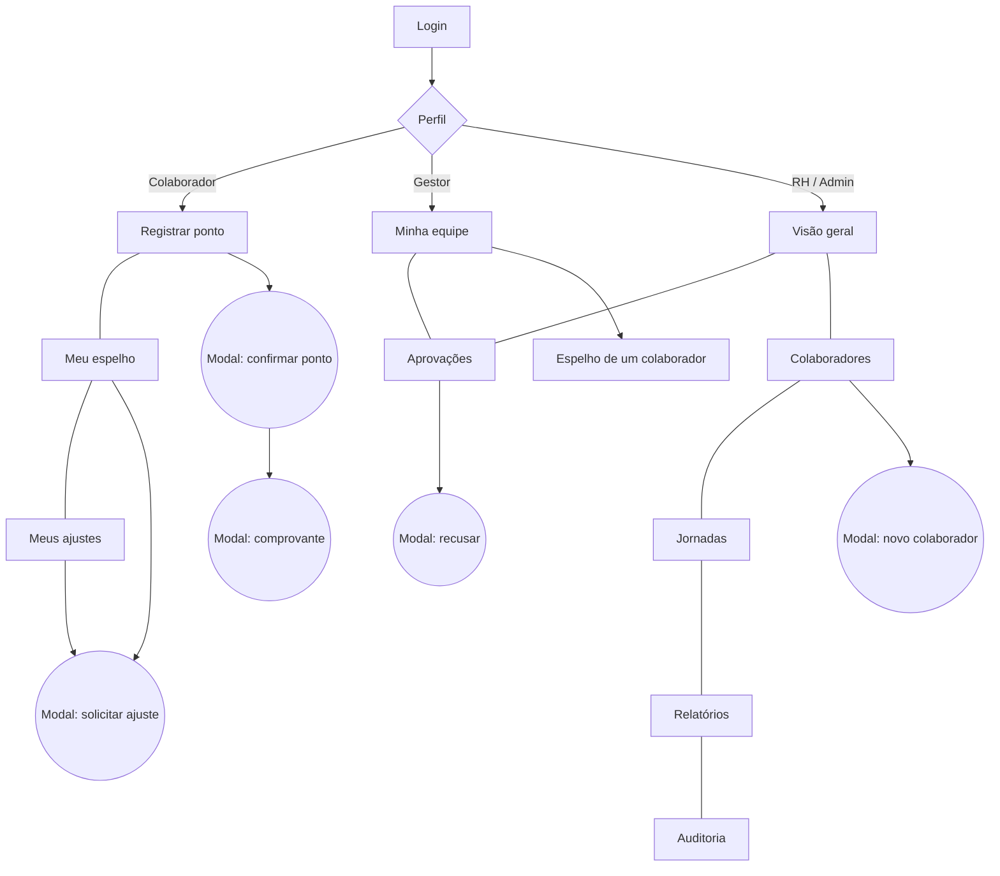

# 05 · Páginas e layout

> Fonte da verdade visual: [`prototipo/index.html`](../prototipo/index.html)

## Mapa de telas

## Estrutura geral

| Elemento | Comportamento |
|---|---|
| **Barra lateral** | Navegação por perfil, nome do usuário, botão Sair. No celular vira uma faixa no topo |
| **Área principal** | Título, subtítulo, ação principal à direita, depois cartões |
| **Modais** | Para ações curtas: confirmar, ajustar, recusar, cadastrar. Fecham com Esc ou clique fora |
| **Aviso (toast)** | Confirma resultados em 3 segundos |
| **Tema** | Claro e escuro automáticos conforme o sistema |

## Telas

### Login
- Duas colunas: formulário e lista de usuários de teste (só no protótipo).
- Erros: credencial inválida com contagem de tentativas, conta inativa, conta bloqueada.

### Registrar ponto (Colaborador)
- **Relógio grande** com segundos.
- **Cartão de localização** logo abaixo: 
  - sem permissão, aviso âmbar "Localização obrigatória" com botão "Permitir localização" e os botões de ponto bloqueados;
  - com permissão, mapa com a pessoa, círculo de precisão, sede, escala, coordenadas, indicação de área da empresa e link para o OpenStreetMap.
- O modal de confirmação repete o mapa.
- **Quatro botões** em linha: já feito (verde, com hora), próximo (verde-água, destacado), futuros (desabilitados).
- Cartão lateral "Hoje": trabalhado, esperado, barra de progresso.
- Cartão "Últimos dias" com três dias anteriores.
- Rodapé do cartão: origem, rede e fuso do registro.

### Meu espelho
- Quatro indicadores: horas, saldo, faltas, dias incompletos.
- Tabela do mês com sábados e domingos acinzentados.
- Chips de situação: Completo, Incompleto, Falta, Em andamento, Ajuste pendente.
- Botão **Ajustar** nos dias com problema.

### Meus ajustes
- Lista com dia, registro, justificativa, resposta do gestor e situação.
- Vazio explica quando usar a tela.

### Minha equipe (Gestor)
- Tabela com situação de agora (Trabalhando, No intervalo, Encerrou, Ausente), último registro, saldo do mês, faltas e incompletos.
- Link para o espelho de cada pessoa, somente leitura.

### Aprovações (Gestor, RH, Admin)
- Pendentes no topo com Aprovar e Recusar; histórico abaixo.
- Contador no menu quando há pendências.

### Visão geral (RH, Admin)
- Indicadores: ativos, trabalhando agora, ajustes pendentes, problemas do mês.
- Barras de presença agora.

### Colaboradores · Jornadas · Relatórios · Auditoria (RH, Admin)
- **Colaboradores:** cadastro, ativar/desativar, redefinir senha.
- **Jornadas:** cartões com horas por dia e semana e quantas pessoas usam.
- **Relatórios:** consolidado mensal por colaborador.
- **Auditoria:** quando, quem, ação e detalhe das ações sensíveis.

## Identidade visual do protótipo

Segue o design system do site [axsys.com.br](https://axsys.com.br), com o logo oficial (cópia em [`assets/brand/`](../assets/brand/)).

| Item | Escolha |
|---|---|
| Logo | `logo-full.png` do site, sobre pastilha branca para funcionar também no tema escuro |
| Fundo | Off-white quente `#fbfaf9` (escuro: `#0d1623`) |
| Texto e botão principal | Navy `#19293e` |
| Destaque | Azul `#25578e`, hover `#1e4674` (escuro: `#78b0ea`) |
| Estados | Verde `#1a7f45`, âmbar `#b5680a`, vermelho `#c0392b`, cada um com fundo suave |
| Fonte | Inter (a mesma do site), números tabulares |
| Cartões | Fundo branco, borda `#e3e1de`, cantos de 20 px, sombra leve |
| Botões | Formato pílula; principal em navy |
| Barra lateral | Clara, item ativo em azul suave |
| Login | Painel navy de apresentação ao lado do formulário |

## Regras de interface

1. Um único botão em destaque por tela.
2. Estado sempre com texto **e** cor (nunca só cor).
3. Horários sempre em fonte monoespaçada e alinhados.
4. Formulários com rótulo visível, erro abaixo do campo.
5. Foco de teclado sempre visível.
6. Nenhuma tabela quebra a página no celular: rolagem horizontal dentro do cartão.
