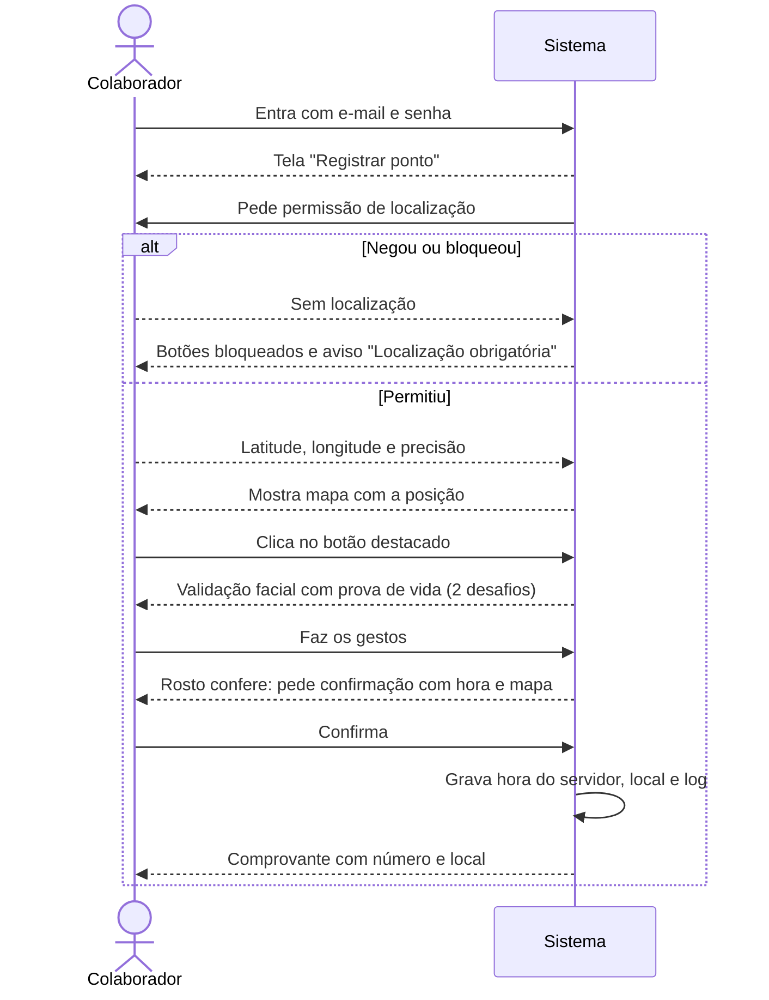
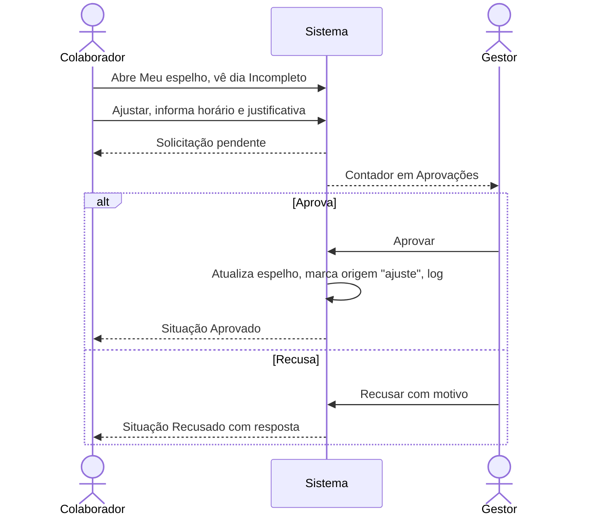
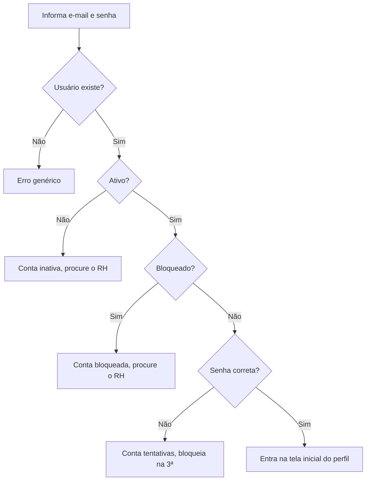
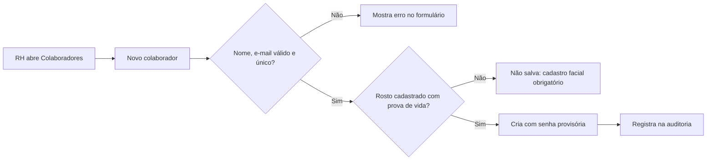
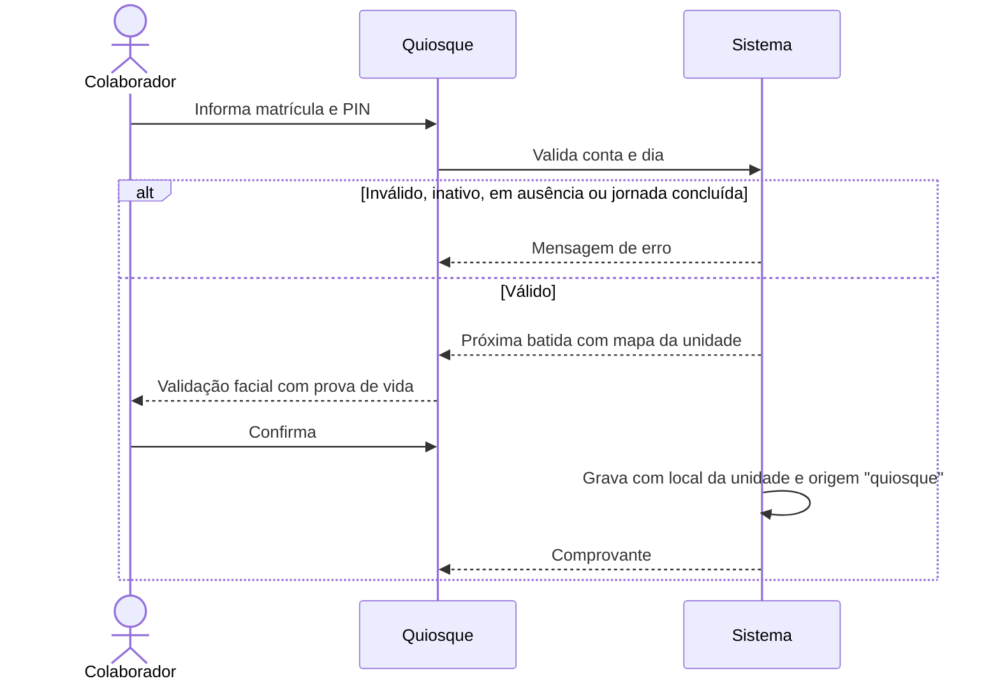
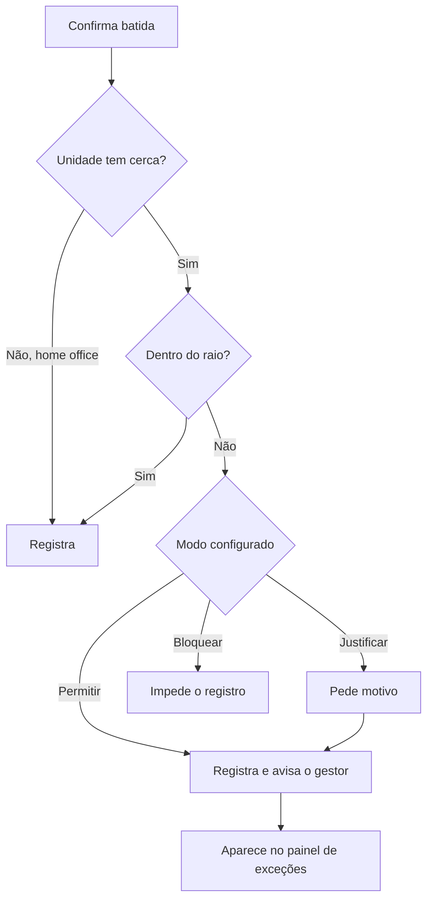
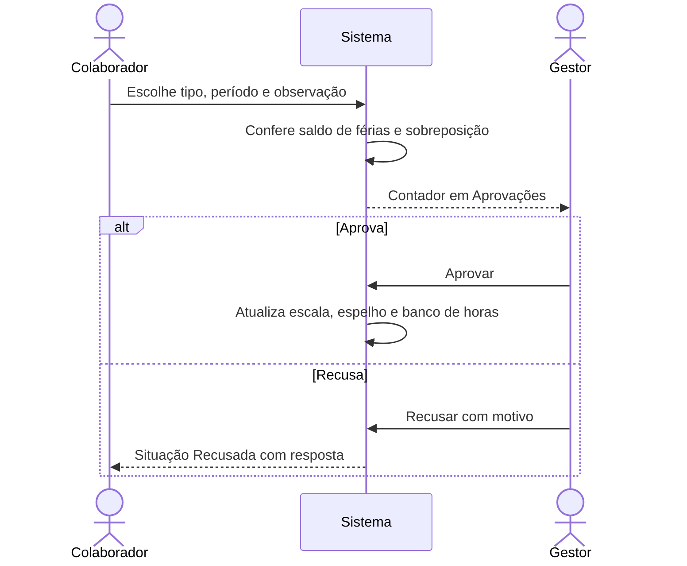
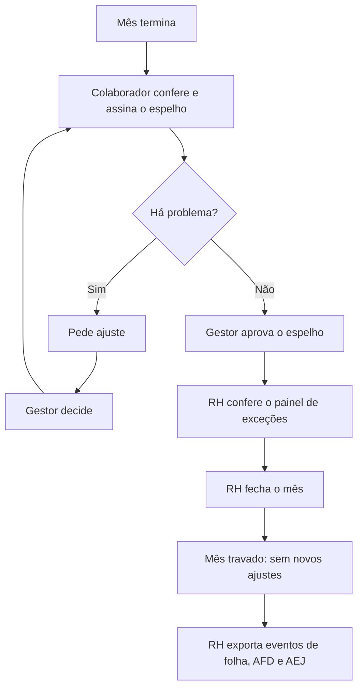
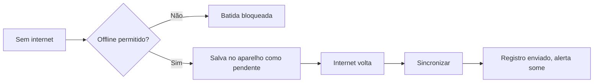
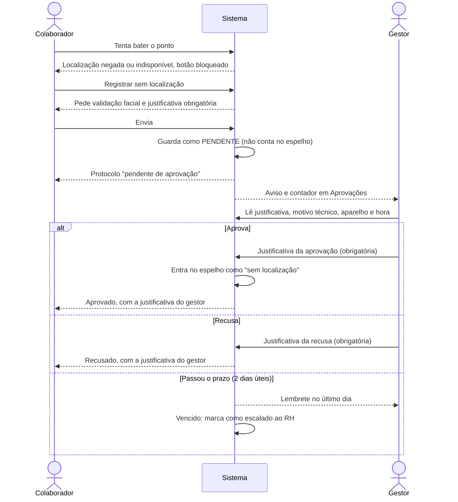

# 06 · Fluxos

## F1 · Registrar o ponto

## F2 · Esqueci de bater o ponto

## F3 · Login

## F4 · Novo colaborador

## F5 · Registrar no quiosque

## F6 · Batida fora da área da empresa

## F7 · Solicitar ausência

## F8 · Fechamento do mês

## F9 · Registro offline

## F10 · Ponto sem localização

